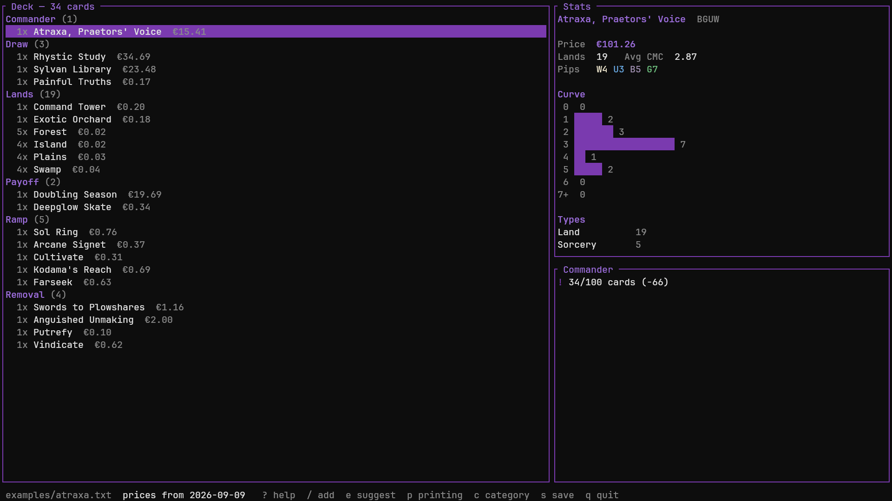

# mtgtuibuilder

[](https://github.com/Lucasldab/mtgtuibuilder/actions/workflows/ci.yml)

A Magic: the Gathering deck builder for the terminal. Archidekt-style
categories, Commander legality checks, Cardmarket prices per printing, card art
in the terminal and EDHREC suggestions. Rust + Ratatui.



## Highlights

- **Card art inside tmux took an upstream fix, which I wrote.** ratatui-image
  drew a whole row of kitty's unicode placeholders into one cell, which tmux's
  grid cannot hold, so images silently never appeared. My fix,
  [ratatui-image#201](https://github.com/ratatui/ratatui-image/pull/201), emits
  one placeholder per cell. It was merged and shipped in ratatui-image 11.1, and
  this project dropped its local workaround for the released crate.
- **Cardmarket prices without a Cardmarket account.** Cardmarket's API needs
  OAuth1 and a registered app. Scryfall republishes the same price guide in its
  bulk data, which needs no key, so prices come from there.
- **Works offline after the first run.** Scryfall's full card file is trimmed to
  the fields the app uses and cached at about 20 MB. Card images and EDHREC
  pages are fetched on a background thread and cached, so the UI never waits on
  the network.
- **Decks stay portable.** Decks are saved as plain-text lists that Archidekt,
  Moxfield and MTGO read too, not in a private format.
- **91 tests that pass without network access.** CI checks formatting, runs clippy with
  warnings as errors, and runs the tests on every push and pull request.

## Install

Needs a Rust toolchain.

```sh
cargo install --locked --git https://github.com/Lucasldab/mtgtuibuilder
```

Or from a clone: `cargo build --release`, then copy `target/release/mtgtuibuilder`
onto your `PATH`.

The first run downloads Scryfall's `default_cards` bulk file (~80 MB
compressed) and caches the trimmed copy in `~/.cache/mtgtuibuilder/`. Later
runs start from the cache.

```sh
mtgtuibuilder                  # scratch deck
mtgtuibuilder decks/atraxa.txt # open or create
mtgtuibuilder --refresh        # re-download; prices update daily upstream
mtgtuibuilder --doctor         # what the image preview will do in this terminal
```

## Keys

| Key | |
|---|---|
| `j` / `k` | move |
| `g` / `G` | top / bottom |
| `Tab` | switch deck ⇄ maybeboard |
| `/` or `a` | search and add a card |
| `+` / `-` | change quantity |
| `d` | remove card |
| `m` | move to the other board |
| `c` | set category |
| `C` | set as commander |
| `p` | choose printing (`0` resets to cheapest) |
| `i` | toggle card image |
| `e` | EDHREC suggestions |
| `s` / `S` | save / save as |
| `?` | help |
| `q` | quit |

## Prices

Prices are **per printing**, because that is how Cardmarket sells cards. A card
defaults to its cheapest printing, and `p` pins a specific one. The deck total
in the stats pane uses the pinned printings. The maybeboard is left out of it.

## Card images

`i` shows the selected card in its pinned printing, so the art matches the
price. Images use kitty's graphics protocol, sixel or iTerm2 where the terminal
supports one, and unicode half-blocks everywhere else. Set
`MTGTUI_IMAGE_PROTOCOL=kitty|sixel|iterm2|halfblocks` to override detection.

On terminals at least 120 columns wide the preview gets its own column.
Narrower, it replaces the stats pane.

Inside tmux, two things are handled automatically:

- **Cell size.** Under tmux the window-size ioctl reports no pixel size, so the
  app reads tmux's own `client_cell_width/height`. Kitty sizes the image from
  the cell grid, so a wrong value puts the image outside the cells meant to
  show it.
- **Re-sending the image.** With `allow-passthrough on`, tmux drops graphics
  from a pane that is not visible. The app asks for focus events and sends the
  image again when the pane comes back.

## EDHREC suggestions

`e` lists the cards EDHREC's decks for your commander play that yours does not.
Each row shows how many of those decks run the card, its synergy score and its
Cardmarket price, with the highlighted card's art beside the list. `Enter` adds
the card and `Esc` closes. Cards already in the deck or the maybeboard are left
out.

EDHREC has no documented API, so this reads the JSON its own pages are built
from. That format can change without notice. Parsing is lenient, a failure
shows a message instead of crashing, and each commander's page is fetched once
and cached in `~/.cache/mtgtuibuilder/edhrec/`.

## Deck format

Archidekt's plain-text format:

```
1x Atraxa, Praetors' Voice (one) 196 [Commander]
1x Sol Ring (ltc) 292 [Ramp]

Maybeboard
1x Mana Crypt (2xm) 270 [Ramp]
```

The quantity can be `1` or `1x`. The printing and the category are optional,
so a bare Moxfield list loads unchanged.

## Commander checks

Card count, singleton (basic lands and *Relentless Rats*-style cards are
exempt), colour identity against the commander, commander eligibility and the
ban list. The maybeboard is not checked.

## Code layout

| Module | Does |
|---|---|
| `scryfall.rs` | downloads and trims the bulk file, loads the cache |
| `deck.rs`, `decklist.rs` | the deck model and its price; reading and writing the text format |
| `commander.rs` | legality checks |
| `stats.rs` | mana curve, colour pips, card types, land count |
| `edhrec.rs` | suggestions from EDHREC's page data |
| `images.rs` | background image fetching and caching |
| `app.rs`, `ui.rs` | state, key handling and drawing |

## Tests

```sh
cargo test
```

Tests that need the card cache skip themselves when it is missing, so
`cargo test` passes on a clean checkout.
`SHOW_UI=1 cargo test renders_a_real_commander_deck -- --nocapture` prints a
rendered frame.

## Licence

MIT, see [LICENSE](LICENSE). Third-party code and data are credited in
[THIRD-PARTY-NOTICES.md](THIRD-PARTY-NOTICES.md).

Not affiliated with Wizards of the Coast, Scryfall, Cardmarket, EDHREC or
Archidekt.
